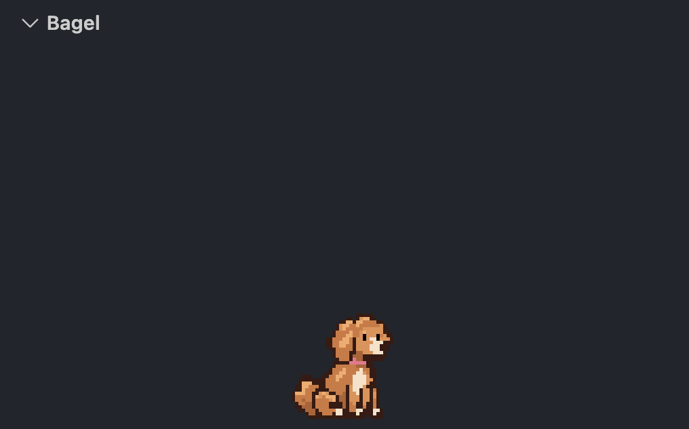

# Bagel

Bagel, a pixel-art goldendoodle, lives in a section of the Explorer sidebar. She walks from one end to the other, sits and wags, blinks, lies down and naps with little Zs.

- She stays inside the section however wide the sidebar is.
- Her Zs are white on dark themes and black on light ones.
- She only moves while her section is open, and keeps still if your system is set to reduce motion.
- Collapse the section and she picks up where she left off when you open it again.

Drag the **Bagel** section anywhere you like, for example next to Source Control's commit graph, and resize it as you please. She stays along its bottom edge.

